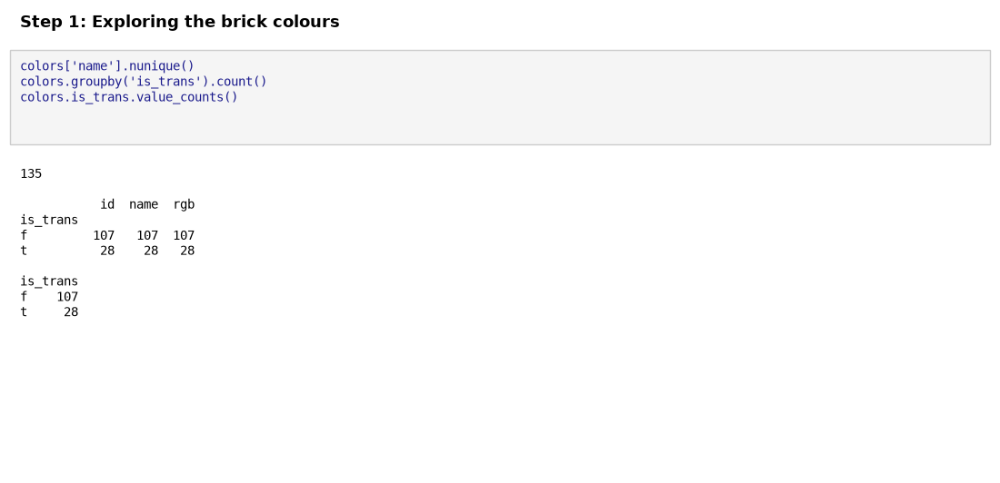
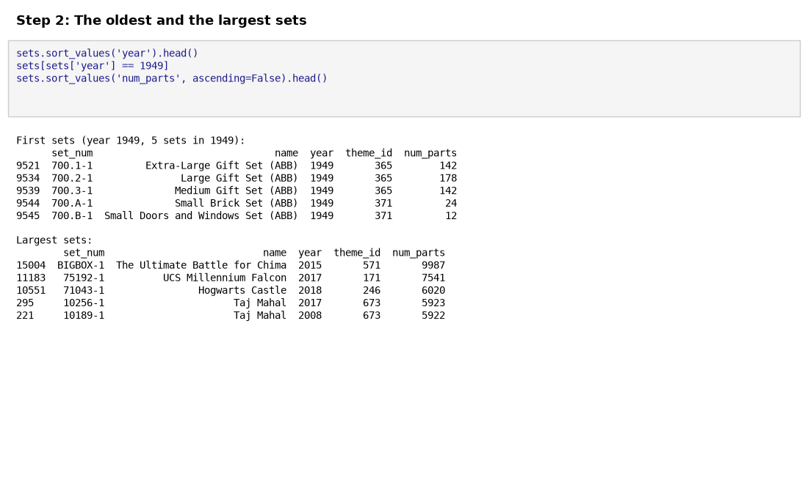
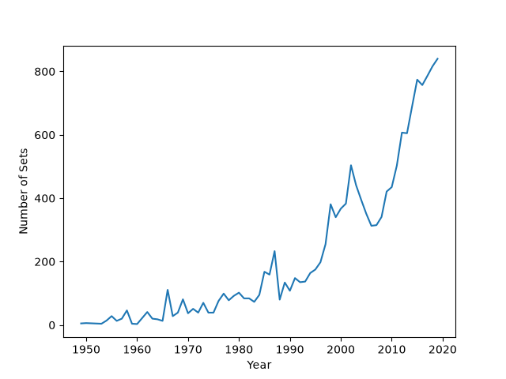
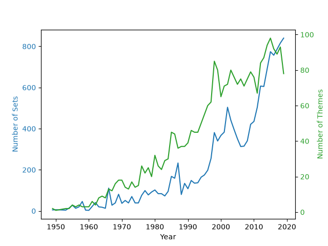
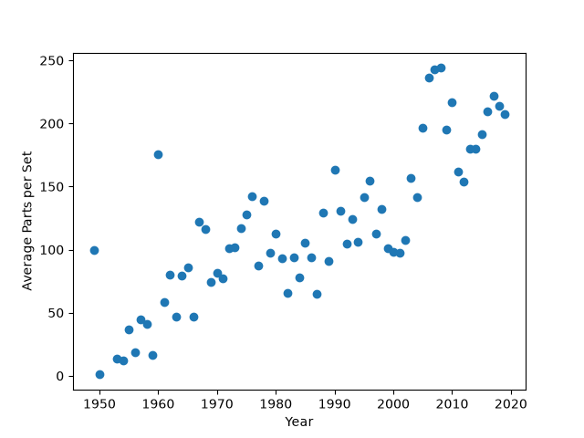
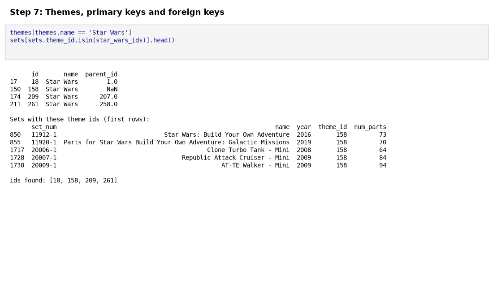
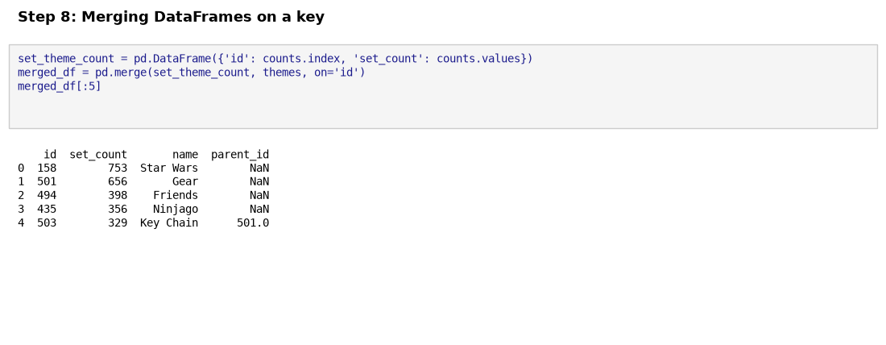
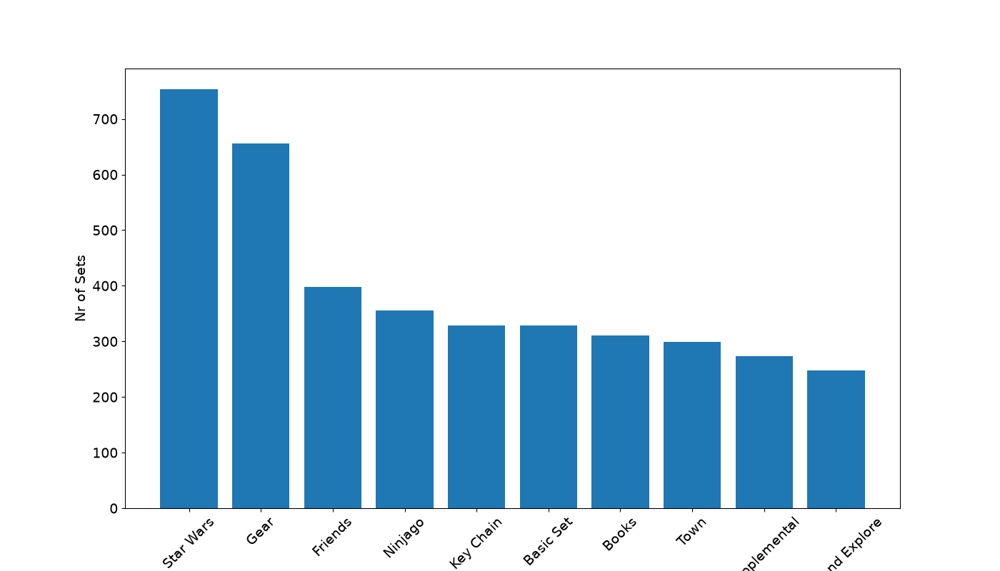

# 🚀 074 LEGO Analysis for Course

Day 74 of Udemy's *100 Days of Code: The Complete Python Pro Bootcamp*: aggregate and merge data in Pandas while analysing a dataset of LEGO sets. It is for course participants who want runnable, tested code and for anyone browsing for ideas.

## 📚 Table of Contents

- [Overview](#-overview)
- [Requirements](#-requirements)
- [Setup](#-setup)
- [Run](#-run)
- [Tests](#-tests)
- [License](#-license)
- [Links](#-links)
- [Appendix: Project documents](#-appendix-project-documents)

## 🧭 Overview

The project answers five questions about LEGO: the largest set ever made, the year of the first sets, the theme with most sets, how the product range grew each year, and whether sets got bigger over time.

| Folder | What it holds |
| --- | --- |
| `src/lego_analysis/` | The analysis functions, named as in the assignment |
| `tests/` | Tests that assert every value from the lecture |
| `notebooks/` | The Jupyter notebook that follows the lecture step by step |
| `data/` | `colors.csv`, `sets.csv` and `themes.csv` from the lecture (a 2020 snapshot of the [Rebrickable][rebrickable] database) |
| `notebooks/assets/` | Images supplied with the lecture, next to the notebook that shows them |
| `docs/` | Project documents, screenshots (`docs/images/`) and the wiki sources (`docs/wiki/`: English, Danish, Bahasa Malaysia) |
| `scripts/` | `scan.sh` (opengrep) and `make_screenshots.py` |

### 🖼️ Lecture steps

One screenshot per lecture step, generated from the code with `python scripts/make_screenshots.py`. The [wiki][wiki] (English, Dansk, Bahasa Malaysia) explains what each step teaches.

**Step 1: Exploring the brick colours**



**Step 2: The oldest and the largest sets**



**Step 3: Sets released per year**



**Step 4: Themes per year with `.agg()`**


**Step 5: Two axes in one chart**



**Step 6: Average parts per set**



**Step 7: Themes, primary keys and foreign keys**



**Step 8: Merging DataFrames on a key**



**Step 9: A bar chart of the top 10 themes**



## 📋 Requirements

- Python 3.13 or newer, to run the code.
- `pandas` and `matplotlib`, the only runtime dependencies; they are installed by the setup below.
- `pytest`, `ruff` and Jupyter, only for development; installed with the `dev` extra.

## 🛠️ Setup

Create and use a local virtual environment named `.venv`.

Windows (PowerShell):

```powershell
python -m venv .venv
.venv\Scripts\Activate.ps1
python -m pip install --upgrade pip
python -m pip install -e ".[dev]"
```

Linux and macOS:

```bash
python3 -m venv .venv
source .venv/bin/activate
python -m pip install --upgrade pip
python -m pip install -e ".[dev]"
```

Leave out `[dev]` if you only want to run the analysis.

## ▶️ Run

Print the answers to the five questions:

```bash
python -m lego_analysis
```

Open the notebook:

```bash
jupyter lab notebooks/Lego_Analysis_for_Course.ipynb
```

## 🧪 Tests

```bash
python -m pytest
python -m mypy
```

`python -m mypy` runs the strict type check configured in `pyproject.toml` on `src` and `tests`.

Before pushing, scan the code with opengrep (default path `~/.opengrep/cli/latest/opengrep.exe`):

```bash
bash scripts/scan.sh
```

## 📄 License

GNU Affero General Public License v3.0, see [LICENSE][license].

## 🔗 Links

- [Repository][repository]
- [Documentation][documentation]
- [Issue tracker][issues]

## 📎 Appendix: Project documents

The documents a newcomer needs, in reading order.

| Document | What it tells you |
| --- | --- |
| [AGENTS.md][agents] | The rules AI agents follow in this repository |
| [Business Case][BC-001] | Why the project exists, its scope and success criteria |
| [Stakeholder Analysis][SA-001] | Who is involved; the stakeholder IDs used for owners and reviewers |
| [Project Plan][PP-001] | The gateways and their schedule |
| [Milestones][milestones] | One document per gateway: Go/No-Go criteria and tasks |
| [Artifact registry][registry] | Where each artifact type lives, the next version, the PO language and domain |
| [Wiki sources][wikisrc] | The lecture steps explained in English, Danish and Bahasa Malaysia |
| [Traceability matrix][TM-001] | How the artifacts link and when each was last reviewed |
| [Framework README][framework-readme] | The framework this project uses |
| [Framework changelog][framework-changelog] | What changed in each framework release |

---

[rebrickable]: https://rebrickable.com/downloads/
[license]: ./LICENSE
[repository]: https://git.tirsystem.com/Tirsvad-Udemy-100-days-of-code/074-Lego_Analysis_for_Course
[wiki]: https://git.tirsystem.com/Tirsvad-Udemy-100-days-of-code/074-Lego_Analysis_for_Course/wiki
[documentation]: https://git.tirsystem.com/Tirsvad-Udemy-100-days-of-code/074-Lego_Analysis_for_Course/wiki
[issues]: https://git.tirsystem.com/Tirsvad-Udemy-100-days-of-code/074-Lego_Analysis_for_Course/issues
[agents]: ./AGENTS.md
[BC-001]: ./docs/business-case.md
[SA-001]: ./docs/stakeholder-analysis.md
[PP-001]: ./docs/project-plan.md
[milestones]: ./docs/milestones/
[registry]: ./docs/artifact-registry.md
[wikisrc]: ./docs/wiki/Home.md
[TM-001]: ./docs/sqa/traceability-matrix.md
[framework-readme]: ./framework/README.md
[framework-changelog]: ./framework/CHANGELOG.md
